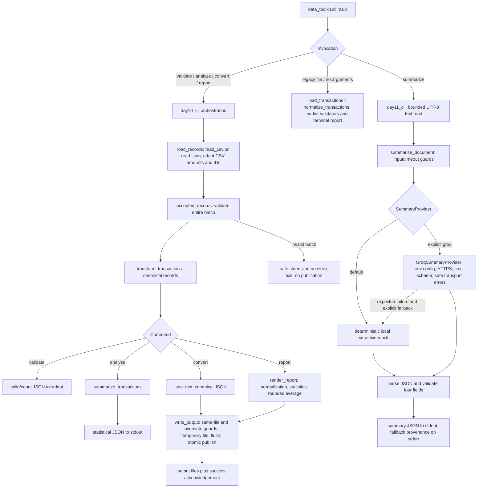

# Application architecture

The diagram describes the inspected public CLI and data flow. It is not a claim
that every operation runs every component. `validate`, `analyze`, `convert` and
`report` share canonical loading and validation, then take separate output paths.

## Responsibility boundaries

- `readers.py` reads files and rejects missing/duplicate CSV headers; it does not
  silently repair ambiguous data or calculate statistics.
- `application.py` adapts historical input, rejects invalid batches, formats
  reports and guards publication. It reuses Day 9 business functions.
- Day 9 validation checks fields/IDs/numeric rules; transformation normalizes
  accepted data; statistics calculates deterministic totals and category summaries.
- `day10_cli.py` owns command parsing and expected-error display. It prints success
  acknowledgements only after publication. Legacy CLI behavior remains separate.
- `summaries.py` owns the vendor-independent provider Protocol, mock, validation
  and explicit fallback. Groq-specific HTTP code remains in `groq_summary.py`.
- The Groq adapter returns JSON text to the service, not directly to consumers.
  Schema-valid data still requires factual review. No key belongs in a prompt.

## Important details omitted from a simple linear pipeline

Public normalization/statistics helpers validate direct callers too, so the code
can normalize an already canonical batch again. Those checks are deliberate.
`render_report` retains the historical rounded-average helper for output stability.
`validate` and `analyze` do not create output files. A convert operation encodes JSON
rather than passing through the text report generator.

`write_output` compares resolved paths and existing file identities, rejects symlink
destinations and unapproved overwrites, then creates a temporary file in the
destination directory. It flushes/fsyncs before publication. Default publication
uses a hard link to refuse races with another creator; force uses replacement.
The temporary file is cleaned in `finally`. Normal filesystem support is required.

Expected errors have safe messages and nonzero statuses. Unexpected programming
errors should remain diagnosable rather than be swallowed by a broad catch. The
legacy error path uses argparse conventions, while modern processing errors use 1.
The historical OpenAI adapter is retained but is not selected by the public CLI.

The source `.mmd` file is editable alongside this explanation. The Word lesson and
downloadable PNG provide a simplified overview; this Mermaid diagram carries the
operation-specific detail. No new runtime diagram dependency was introduced.
